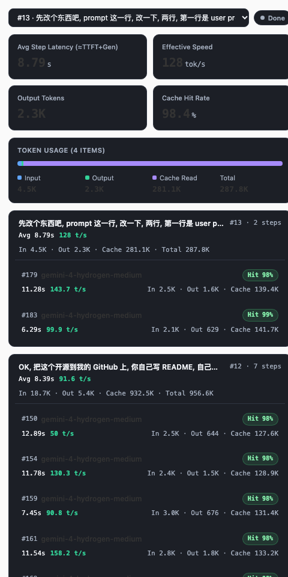

# Run Telemetry for Antigravity

An Antigravity plugin that displays per-run LLM latency, effective token throughput (`tok/s`), cache hit/miss status, and 4-part token usage (`Input`, `Output`, `Cache Read`, `Total`) in the right auxiliary pane.



## Features

- **Per-Run & Session KPI Summary**: Average step latency, effective output speed (`tok/s`), estimated USD cost (based on built-in Gemini pricing), and cache hit rate. Defaults to full-session accumulation (`All Runs`), with quick switching to `Latest Run (Auto)` or any individual run.
- **Subagent & Swarm Aggregation**: Automatically discovers child conversations from `.system_generated/swarm/members.json`, `invoke_subagent` tool calls, and `ConversationService/ListConversations`, combining them into `All (Main + Subagents/Swarm)` with dedicated child cards.
- **Daily Cross-Session Summary (`Daily` Tab)**: Switch between `Session` and `Daily` at the top. Pick any date (`‹` / `›` / date picker / `Today`) to view total daily cost, latency, speed, 4-item token totals, and a per-model breakdown across all conversations.
- **Context Window & Live Tasks (`Context` Tab)**: Powered by [antigravity-status-bar](https://github.com/ballShell/antigravity-status-bar) (MIT), parses the local SQLite/Protobuf conversation DB read-only (0 extra tokens) to show segmented context window usage (`System / User / Agent / Tools / Rules / MCP / Subagents`), compaction budget tick, background task logs, and checkpoints.
- **4-Item Token Breakdown**: Stacked proportion bar and exact counts (`K`-formatted with 1 decimal place above 1,000) for `Input`, `Output`, `Cache Read`, and `Total`.
- **Full Session Run Cards**: Lists every Agent RUN in the current conversation (newest first), titled by the first line of the user prompt.
- **Two-Line Step Details**: Each LLM invocation shows model name + rounded **`Cache Miss`** / **`Hit XX%`** pill on row 1, and latency, `t/s`, and `In / Out / Cache` tokens on row 2.
- **Zero External Dependencies**: Pure Node.js built-ins + Antigravity's built-in `sidecar_sdk`. Auto-adapts to dark/light themes.

## Installation

Clone directly into your Antigravity global plugins directory:

```bash
git clone https://github.com/a1398394385/antigravity-run-telemetry.git ~/.gemini/config/plugins/run-telemetry
```

No `npm install` or build step is required. Antigravity discovers it automatically—open the **Telemetry** tab from the `+` menu in the right auxiliary pane.

## Updating

Pull the latest changes in place:

```bash
git -C ~/.gemini/config/plugins/run-telemetry pull
```

- **Frontend-only changes (`index.html`)**: Close and reopen the **Telemetry** tab in the right pane.
- **Backend or hook changes (`main.mjs`, `lib/telemetry.mjs`, `hooks.json`)**: Toggle **Run Telemetry** off and back on in Antigravity Customizations to restart the sidecar.

## How It Works

1. **Lifecycle Hooks (`hooks/record_timing.mjs`)**: Listens to `PreInvocation`, `PreToolUse`, `PostInvocation`, and `Stop` to append millisecond timestamps to `<artifactDirectoryPath>/.system_generated/logs/run_telemetry.jsonl`.
2. **Sidecar Backend (`sidecars/telemetry_pane/main.mjs`)**: Pairs Hook timing spans with token counts from `transcript_full.jsonl` via shared parser `lib/telemetry.mjs` and serves `/api/telemetry`.
3. **Sidecar Web UI (`sidecars/telemetry_pane/index.html`)**: Polls `/api/telemetry` every 1.5s while visible.

### Measurement Note

Antigravity's current Hook API does not expose a streaming first-token event (`OnFirstToken`), so **Avg Step Latency** measures end-to-end step duration (`PreInvocation` to first tool call / `PostInvocation` / `Stop`), and **Effective Speed** measures `output_tokens / step_duration`. Steps recorded before installing the plugin will show `—` for timing/speed while still displaying exact token counts.

## License

MIT
